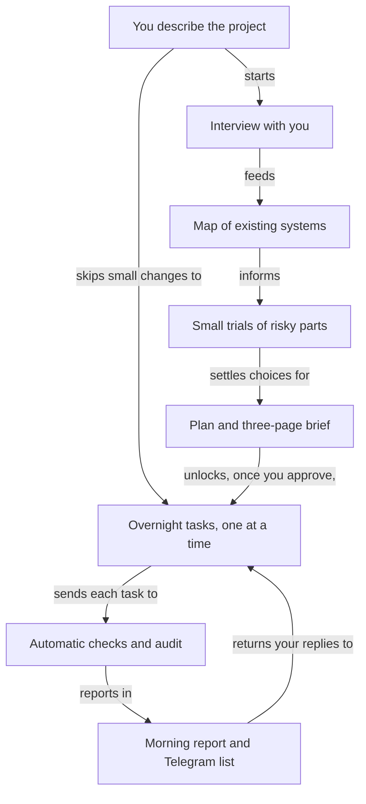
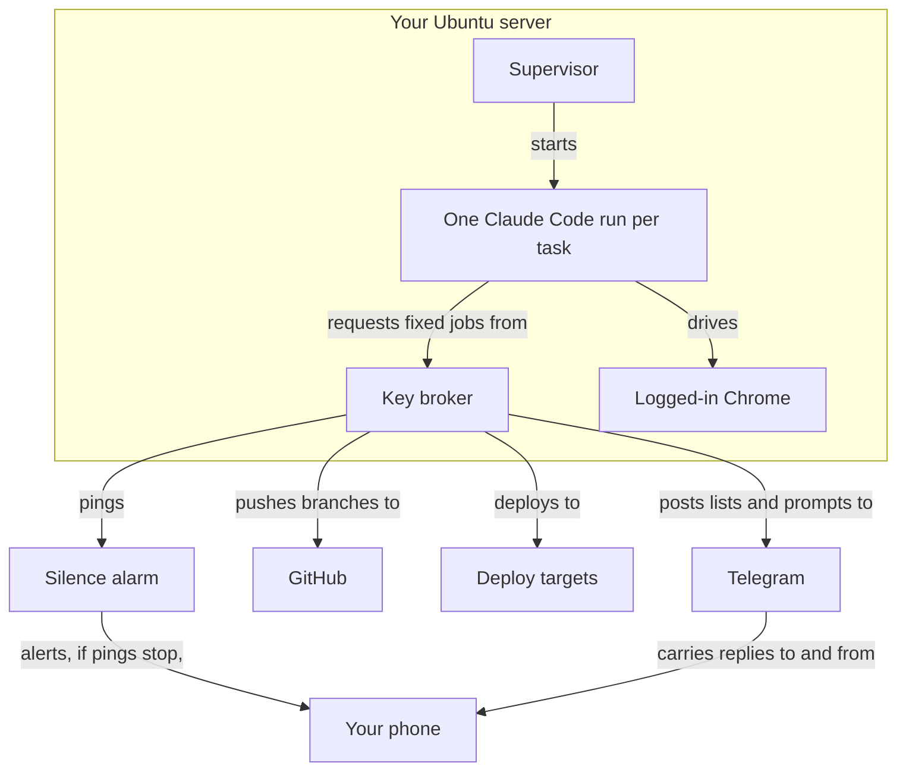

# Your autonomous engineer: the brief

## Page 1

### What the engineer is and how a project flows

The engineer is a packaged Claude Code setup that takes a project from your spoken brief to deployed, checked software, with you only designing and approving. It runs on one Ubuntu server (rented machine) you control. Once you approve a plan, a supervisor (control program) works through small tasks overnight, one fresh Claude Code run per task, each capped in turns, money and time. Scripts decide when a task is done, never the model's own claim, and two failed tries park a task instead of looping.

1. You describe the project. A one-sentence change skips to step 6.
2. Interview: one question at a time, with you present. "I don't know" gets at most 5 researched options.
3. An existing system is mapped read-only; you sign off the map.
4. Risky claims get small trials (boxed tests), at most 3 paths. Failures are logged, not retried blindly.
5. It writes the plan and a three-page brief. Your approval is locked to that exact version.
6. Overnight: build, automatic checks, a script audit, one pull request (proposed change) per task.
7. A big change of course (goal, scope, cost) comes back to you; other tasks carry on.
8. Every night ends in a known state, with a morning report and one Telegram list.

## Page 2

### The stack and where it runs

| Tool | What it does | Cost |
| --- | --- | --- |
| Claude Code | The only engine and writer | Your Max plan, or pay per use with an API key (prices not checked) |
| Supervisor | Runs tasks, enforces caps, writes the report | Free, built for you |
| Ubuntu server | Holds everything; default 4 CPUs, 8 GB | Not verified; one source says $5 a month |
| Encrypted key file | Holds every secret | Free |
| Telegram bot | Daily list and urgent prompts | Free |
| Playwright and Chrome | Browser-only work, such as Attio views | Free |
| Free scanners | Security gate on every change | Free |
| GitHub | One pull request per task | Free; self-merge on a private repo needs GitHub Pro, price not verified |
| Cloudflare, Cloud Run, Neon | Where apps deploy | Free tiers |
| healthchecks.io | Alerts you if the engineer goes silent | Free |

**Where every key lives**
- Service keys, main tokens, the approvals bot: an encrypted file only a separate broker (key-holding account) reads. The engineer never sees a value.
- Trial test keys: added on the wire by a proxy (network gatekeeper).
- Cloud deploy keys: none stored; short-lived tokens per job.
- Browser logins: the Chrome profile, readable by the engineer account.
- Your Max login: Claude Code's own store; whether the model can read it is unchecked.
- An API key, if chosen: the encrypted file, passed only into task runs, treated as exposed, so every run has a spend cap.
- Production, billing, backups: only you.

**What you will see day to day**
- **Morning report:** what finished, what is blocked and why.
- **Daily Telegram list** at 07:30: numbered lines with recommended defaults. Reply "all y" or "1 y 2 n"; unclear replies never approve. Reversible items take their default after 24 hours (untested).
- **Instant hard-gate prompts:** spending money, deleting data, app-store submission. Typed confirmation; never defaults to yes.

## Page 3

### What you do and what is still open

**Your one setup sitting.** After a short bring-up (rent the server, run one install script, log in to Claude), one block, long waits first:
1. Start slow approvals: Outreach app (needs your employer's OK), Google sign-in app, WHOOP and Withings developer apps.
2. Sign up for healthchecks.io and UptimeRobot.
3. Make a GitHub bot account, its token and branch protection.
4. Merge the builder's first pull request.
5. Two Telegram bots; Remote Control (phone view) push.
6. Cloudflare account and one main token.
7. Attio and n8n keys, Clay sign-in, Google Cloud roles, Slack token.
8. Log in to Google, Attio, Clay, n8n and Outreach in the server's browser; click every consent screen.
9. Privacy toggle, confirm hard gates, run the lock command.

Time: a worker's unsourced guess of 45 to 90 minutes, to be timed.

**How strong is this?** The evidence is mostly vendor docs and benchmarks. Nothing has been run or installed, and many settings (caps, timeouts, server size, allowed websites) are untested defaults. A hand check of 20 citations found none wrong, but only 14 fully supported against a bar of 17, because some summaries added detail beyond their sources. Those were corrected.

**Unproven, to test first**
1. Whether unattended Claude Code on your Max login fits Anthropic's terms.
2. What each login choice loses: phone view, connectors, page publishing.
3. Whether turn, money and time caps stop runs cleanly.
4. Whether the "done" checks block a false "done" with nobody watching.
5. Whether the sandbox (locked box) resists bypass tricks, and a planted fake secret never reaches logs.
6. Whether it pauses at a usage limit and resumes alone.
7. Whether each sign-in consent lands its token for Google, Outreach, WHOOP, Withings and Slack.

**Decisions only you can make, with the default meanwhile**
- **Max login or API key?** No overnight runs until you choose; all else works either way.
- **Self-merge via GitHub Pro, a public repo, or local-only?** Off; each pull request is a list line. Then two weeks of it proposing while you merge.
- **Where does your GTM setup live?** Its first task is the access list and exports.
- **Do you have 1Password?** The encrypted file.
- **Hard gates beyond money, deleting, app stores?** None; production releases are list items defaulting to "hold".
- **Rented or home server, shared with the health app?** A separate server.
- **May anything outside Anthropic see health data?** No.
- **Where does n8n run; may it write to Outreach?** n8n stays put; no Outreach writes.

**How your GTM scenario fares.** Of 26 steps, 21 have a mechanism (17 covered, 4 partly). The 5 gaps:
- Finding where your GTM setup lives.
- Reading Clay table contents and column settings.
- A safe way to merge Attio duplicates (it reports them instead).
- Browser re-logins stay your clicks, how often unknown.
- Importing an old project's to-do list.

**What building it starts with.** You copy this repo into a new private repo. A cloud session reshapes it into the engineer's template as one pull request you merge, then re-reads Anthropic's terms and writes the Max-or-API-key page. No server or keys yet.
